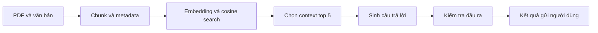

# Phân tích nguyên nhân lỗi và vị trí cần cải thiện

**Phạm vi:** phân tích Task 7 này dùng lần chạy embedding ngày **05/11/2026**, không phải lần so sánh bốn nhánh sau đó. Đã có [đối chiếu với output Task 6 mới](../task6_4way/README.md): corpus/model/context embedding giữ nguyên nhưng system prompt và output budget đổi; một số ca lỗi đã thay đổi. Các số như 6/8 và mô tả đáp án cụ thể bên dưới chỉ áp dụng cho lần chạy cũ, không gộp vào thống kê mới.

## 1. Kết luận theo pipeline

**Ưu tiên cải thiện khâu sinh đáp án và hậu kiểm; retrieval có những ca thiếu nguồn cần xử lý riêng.** Trong 8 câu RAG sai trọng yếu hoặc không có đáp án, **6 câu đã nhận đủ bằng chứng tham chiếu trong prompt**: Q03, Q04, Q05, Q12, Q13, Q19. Hai câu còn lại là Q07 và Q16 vừa thiếu nguồn vừa có lỗi sinh đáp án.

Phân tích dùng output FP32 + SDPA đã lưu, đọc prompt thực tế, xếp lại toàn bộ 162 vector đã lưu và thử các hàm kiểm tra hiện tại. Không có lần chạy model mới trong phân tích này. Nhãn/reference vẫn cần nhóm đối chiếu PDF; đây là chẩn đoán theo dữ liệu hiện có.

| Bước | Điều đã xác nhận | Kết luận chẩn đoán |
|---|---|---|
| PDF/OCR | Các số liệu và điều kiện đúng đã có trong prompt của nhiều câu trả sai. Corpus vẫn còn trang OCR chưa được duyệt độc lập. | Chưa có bằng chứng OCR là nguyên nhân trực tiếp của 8 ca lỗi này. Chất lượng nguồn vẫn là việc cần duyệt. |
| Chunking | Q16 tách điều về tài năng thành một mảnh quy định bậc 4 và một mảnh danh sách chứng chỉ IELTS 5.0. | Tách chunk làm phát sinh nhu cầu lấy thêm mảnh liên quan; dữ liệu không bị mất khỏi corpus. |
| Embedding/index | Vector hữu hạn, checksum/fingerprint đã được kiểm tra; các chunk chứa đáp án đều tồn tại. Đoạn cần cho Q07 xếp hạng 11. | Với Q07, vấn đề nằm ở thứ hạng và ngưỡng top-k; chưa có căn cứ kết luận thuật toán cosine hoặc cache bị hỏng. |
| Chọn và tạo context | Chỉ lấy top-5 theo cosine, ghép nguyên các chunk. Không có reranking, lọc đối tượng hay mở rộng điều/mục được dẫn chiếu. | Có thể thiếu mảnh cần thiết và đồng thời đưa vào nhiều quy định gần chủ đề nhưng khác điều kiện. |
| Sinh đáp án | 6/8 câu lỗi nặng có đủ bằng chứng. Có đọc nhầm hệ đào tạo/cột bảng, đảo phạm vi, tính sai và bỏ yêu cầu câu hỏi. | Đây là điểm yếu lớn nhất đã quan sát trong lần chạy. Chưa tách được ảnh hưởng riêng của model, prompt và cách trình bày context. |
| Hậu kiểm | Placeholder có chữ vẫn được chấp nhận; ID sai chỉ được ghi vào audit, không chặn kết quả. | Pipeline để các lỗi đã phát hiện được đi tới người dùng. |
| Đánh giá | Metric phần thân bỏ qua chú giải nguồn được lặp lại trong context. | Có thể chẩn đoán nhầm lỗi generator thành thiếu nguồn retrieval, như Q12/Q13. |

## 2. Những nguyên nhân đã loại trừ trong lần chạy này

- **Không bị cắt input:** prompt RAG dài 2.436–4.702 token, thấp hơn giới hạn 8.192; mọi `omitted_context_ids` đều rỗng.
- **Không bị cắt chunk khi embedding:** chunk dài nhất theo tokenizer BGE-M3 là 530 token, giới hạn model là 8.192.
- **Có một ca cắt output:** Q03 đạt 384 token. Tuy nhiên kết luận 8–20 sai ngay từ đầu, nên giới hạn output chỉ làm câu trả lời chưa hoàn tất, không giải thích được toàn bộ lỗi.
- **Lỗi dấu `!` trước đó không thuộc bộ output đang đánh giá:** đây là lần chạy FP32 + SDPA, đã sinh đủ 20 cặp đáp án. Sửa độ chính xác số học của runtime không bảo đảm model hiểu đúng nội dung tài liệu.

## 3. Phân tích từng ca cần cải thiện

| Câu | Sai thế nào | Bước lỗi chính | Vì sao xác định được | Cải thiện cần thử |
|---|---|---|---|---|
| Q03 | Trả 8–20 thay vì 12–25 tín chỉ cho đại trà/tài năng; tự mâu thuẫn và bị cắt. | **Sinh đáp án: chọn sai đối tượng**, kèm giới hạn output. | Top-1 đã ghi đủ mức của từng hệ. Số 8 và 20 thuộc nhóm chương trình khác ngay trong nguồn. | Xác định `chương trình`, `loại học kỳ`, `đại lượng` trước khi lấy số; yêu cầu trích đúng dòng của đối tượng. Rút phần trả lời lan man trước khi thử tăng token. |
| Q04 | Đảo nhóm khóa áp dụng quy định mới. | **Sinh đáp án: xử lý phạm vi và điều kiện.** | Top-1 có cả khóa từ 2026–2027 và quy tắc chuyển tiếp cho khóa cũ. | Trích riêng mốc khóa, đối tượng và điều kiện chuyển tiếp; giữ các từ hạn định như “lựa chọn”, “có lợi hơn”, không đổi thành “chỉ áp dụng”. |
| Q05 | Chỉ xuất `[TBC_ID]`. | **Sinh đáp án + hậu kiểm.** | Nguồn top-1 có đủ điều kiện. Hàm kiểm tra chỉ yêu cầu có chữ nên vẫn nhận placeholder này. | Đầu ra có trạng thái, đáp án và bằng chứng; từ chối placeholder, yêu cầu sinh lại có giới hạn hoặc báo lỗi/chưa đủ căn cứ. |
| Q07 | 68 điểm bị xếp Trung bình 50 thay vì Khá. | **Retrieval + sinh đáp án khi thiếu nguồn.** | Đoạn ngưỡng 65–79 = Khá ở hạng 11; top-5 chứa quy định về nghỉ học/không đăng ký học phần có kết quả 50 điểm. | Mở tập ứng viên rồi xếp hạng lại theo câu hỏi về ngưỡng; lấy đúng điều xếp loại. Không suy kết quả từ một quy định về nhóm đối tượng khác. |
| Q08 | Ý 50 điểm đúng, nhưng khái quát sai cách tính thời gian nghỉ học. | **Sinh đáp án: thêm ý và bỏ điều kiện.** | Điều 20 phân biệt nghỉ vì lý do cá nhân khác với các trường hợp ngoại lệ. Output bỏ sự phân biệt này. | Tập trung vào điều được hỏi; mỗi ý bổ sung phải giữ đủ điều kiện và có đoạn hỗ trợ riêng. |
| Q11 | Thiếu đơn giá theo năm học; sinh nhãn nguồn giả. | **Sinh đáp án: thiếu thành phần + citation.** | Nguồn đã có cả số tiết, mức thu theo năm và quy đổi 15 tiết. | Đối chiếu đủ các vế của câu hỏi; yêu cầu mã nguồn thật cho kết luận, kiểm tra trước khi trả. |
| Q12 | Lấy C4 = 734.000 thay cho C5 = 1.014.000 đồng. | **Sinh đáp án: đọc sai cột bảng.** | Dòng ngành AI và chú giải C5 đã cùng có trong prompt. | Biểu diễn bảng bằng trường có tên: ngành, khối kiến thức, cột C5, đơn giá, đơn vị, năm/khóa; kiểm tra giá trị lấy từ đúng cột. |
| Q13 | Có hai giá đúng nhưng gọi là C1 và trừ ra 230.000 thay vì 40.000. | **Sinh đáp án: gán nhãn cột và tính toán.** | Cả hai dòng ngành cùng chú giải đã được cung cấp. Phép trừ chính hai số model nêu cũng sai. | Xác thực hai giá trị C5 từ nguồn, dùng phép tính Python xác định, rồi diễn đạt lại bằng ngôn ngữ. |
| Q14 | Kết luận về khóa 2020 đúng nhưng mở rộng phạm vi thành mọi khóa từ 2022 trở lên. | **Sinh đáp án: khái quát quá phạm vi.** | Văn bản quy định danh sách khóa 2022–2026. | Giữ giới hạn trên/dưới của tập khóa; không đổi khoảng hữu hạn thành “trở lên”. |
| Q16 | Nói đại trà và tài năng khóa 2024 đều IELTS 4.5/bậc 3. | **Retrieval mảnh liên quan + sinh đáp án chọn sai nhóm.** | Đã lấy Điều 8 về tài năng khóa 2023 trở đi/bậc 4, nhưng mảnh IELTS 5.0 ở hạng 6 bị loại. Model còn bỏ qua bậc 4 đã có. | Lấy tiếp mảnh cùng `section_id` hoặc theo dẫn chiếu; kiểm tra đủ hai nhóm cần so sánh trước khi kết luận. |
| Q19 | Trả khoản chứng chỉ có ghi hiệu lực, bỏ quy tắc 2 năm cho chứng chỉ không ghi hiệu lực. | **Sinh đáp án: chọn sai nhánh điều kiện**, kèm citation sai. | Cả khoản 11.1 và 11.2 đều nằm trong top-1. | Xác định điều kiện `có/không ghi hiệu lực`, chọn đúng khoản rồi trích thời hạn và mốc tính. |

**Hai câu đáp án đúng nhưng bằng chứng còn thiếu:** Q15 chưa lấy đoạn xác nhận IELTS 4.5, ở hạng 10; Q17 chưa lấy đoạn về chuẩn trong quá trình học, ở hạng 12. Cần sửa retrieval cho cả những câu này, vì trùng đáp án tham chiếu chưa chứng minh được trả lời dựa đủ trên nguồn đã nhận.

## 4. Vì sao cấu hình hiện tại dễ gặp các lỗi này?

### Retrieval chỉ có một bước xếp hạng cosine

[`search()`](../../rag_embedding.py#L66) trả thẳng các chunk có cosine cao nhất. [`GENERATION_TOP_K = 5`](../../scripts/build_kaggle_notebook.py#L57) giới hạn context cho generation. Từ vector đã lưu, xác định được:

| Câu | Mảnh còn thiếu | Hạng cosine |
|---|---|---:|
| Q07 | `D02_regulation_article_7_01`: ngưỡng xếp loại | 11 |
| Q15 | `D04_regulation_article_7_01`: IELTS 4.5 | 10 |
| Q16 | `D04_regulation_article_8_02`: IELTS 5.0 | 6 |
| Q17 | `D04_regulation_article_6_01`: chuẩn trong quá trình học | 12 |

Như vậy, tăng top-k từ 5 lên 10 vẫn thiếu nguồn cho Q07 và Q17 trong bộ này. Hướng thử hợp lý là lấy tập ứng viên rộng hơn, xếp hạng lại và bổ sung mảnh liên quan trước khi chọn context cuối. Chọn tham số trên tập validation; không dùng các hạng đã biết của 20 câu này để tuyên bố tham số tối ưu trên câu hỏi mới.

### Context chưa làm rõ cấu trúc điều kiện

[`rag_messages()`](../../rag_embedding.py#L111) ghép nguyên các chunk, metadata và URL. Context có thể chứa nhiều hệ đào tạo, khóa, điều khoản và cột bảng cùng lúc. Model phải tự chọn điều kiện rồi tự trả lời trong một lượt.

Output Q03/Q04/Q12/Q19 xác nhận model chọn hoặc diễn đạt sai thông tin đã có. **Việc model 1.5B chưa đủ năng lực, context nhiều thông tin gây nhiễu, hay prompt chưa phù hợp là các giả thuyết cần thử tách biệt.** Chưa có phép thử thay riêng model hoặc riêng prompt để kết luận nguyên nhân duy nhất là kích thước model.

### Kiểm tra đầu ra mới dừng ở lỗi rất thô

[`validate_answer_text()`](../../rag_embedding.py#L150) chỉ kiểm tra có ký tự chữ; `[TBC_ID]` và `[chunk_id]` đều vượt qua. [`citation_audit()`](../../rag_embedding.py#L142) phát hiện một số ID sai nhưng:

- `has_citation=True` nghĩa là có chuỗi khớp regex, không có nghĩa ID hợp lệ.
- Mã ngoài ngoặc vuông như `chunk_id_1` không được regex thu nhận.
- [`answer_from_hits()`](../../scripts/build_kaggle_notebook.py#L215) ghi audit vào JSON rồi trả đáp án; không yêu cầu citation hợp lệ, không sinh lại và không gắn trạng thái lỗi nội dung.

Đây là lý do lỗi placeholder/citation có thể được phát hiện về mặt kỹ thuật nhưng vẫn xuất hiện như đáp án. Kiểm tra ID hợp lệ cũng chưa phát hiện được một kết luận sai nhưng dẫn đúng chunk; cần đánh giá thêm nguồn có hỗ trợ kết luận và điều kiện áp dụng hay không.

## 5. Thứ tự ưu tiên cải thiện

| Ưu tiên | Thay đổi | Kết quả mong muốn và cách kiểm tra |
|---|---|---|
| **1 — Generator và cách đưa thông tin vào** | Thử yêu cầu trích bằng chứng/đối tượng/điều kiện trước khi kết luận; so sánh một generator khác với đúng các prompt đã lưu. | Q03/Q04/Q05/Q19 phải xử lý đúng nguồn đã có. Đánh giá trên toàn bộ câu, gồm cả câu từ chối; không chỉ đếm câu được chấp nhận. |
| **2 — Bảng và tính toán** | Tạo cấu trúc trường có tên từ bảng nguồn, kèm provenance; dùng phép tính xác định cho câu so sánh số liệu. | Q12 lấy C5 = 1.014.000; Q13 trả chênh lệch 40.000 và đúng đơn vị. Cấu trúc dữ liệu lấy từ tài liệu, không tạo từ đáp án benchmark. |
| **3 — Hậu kiểm đầu ra** | Kiểm tra trạng thái, đáp án thực chất, ID trong context, quote từ nguồn và trường điều kiện bắt buộc; xử lý không đạt bằng sinh lại có giới hạn hoặc từ chối. | Chặn Q05 và citation giả. Báo cả độ đúng, tỷ lệ trả lời và tỷ lệ từ chối; một bộ lọc từ chối nhiều hơn chưa chứng minh generator tốt hơn. |
| **4 — Retrieval nhiều bằng chứng** | Lấy tập ứng viên rộng hơn rồi rerank; lọc metadata khi xác định chắc tài liệu/khóa/chương trình; lấy mảnh cùng điều hoặc được dẫn chiếu khi cần. | Đo coverage Q07/Q15/Q16/Q17, độ chính xác câu trả lời và lượng context/độ trễ. Tránh lọc mất văn bản sửa đổi hoặc một vế của câu hỏi so sánh. |
| **Thực hiện kèm mọi thử nghiệm — Đánh giá** | Tính riêng coverage phần thân và toàn context có provenance; sửa cách nhận diện citation, chấm chéo nội dung. | Phân biệt lỗi retrieval với lỗi generator. Với Q12/Q13, chú giải lặp là nguồn đã nhận, không phải bằng chứng bị thiếu. |

Chú giải bảng được lặp lại có vị trí nguồn trong `context_source_spans`. Khi tính thêm phần này, Evidence Recall@5 trung bình theo câu là 89,17% và All Evidence Hit@5 là 80%, so với 85% và 70% của metric phần thân. Hai bộ số liệu được giữ riêng để đối chiếu.

## 6. Những thử nghiệm giúp xác định đúng nguyên nhân

1. **Kiểm tra thiếu nguồn:** giữ model/prompt/decoding, bổ sung đúng mảnh nguồn bị thiếu cho Q07/Q15–Q17. Chỉ đưa tài liệu nguồn, không đưa đáp án tham chiếu. Kiểm tra ngân sách token và xem lỗi còn hay không. Đây là thử nghiệm chẩn đoán, không phải retrieval dùng khi triển khai.
2. **Kiểm tra model:** giữ nguyên từng prompt/context đã lưu, thay riêng generator. Nếu số câu đúng tăng, có bằng chứng generator là một yếu tố; vẫn phải chấm lại toàn bộ output và citation.
3. **Kiểm tra cách trình bày context:** giữ model và nội dung nguồn, thử biểu diễn điều kiện/bảng bằng trường có tên. Không đồng thời đổi embedding hoặc top-k trong phép so sánh này.
4. **Kiểm tra số học và hậu kiểm:** giữ nguồn và model, thêm tính toán xác định; đánh giá bộ kiểm tra bằng cả placeholder/ID sai đã có và các đáp án đúng. Kiểm tra tỷ lệ chặn nhầm.

Mỗi thử nghiệm cần ghi phiên bản model, prompt, corpus, cấu hình và chạy lại trên cùng bộ câu để so sánh; sau khi chọn cấu hình, dùng thêm câu hỏi độc lập. Hiện chưa chạy các thử nghiệm này nên chưa có số liệu chứng minh mức cải thiện của từng đề xuất.

## 7. Bằng chứng và giới hạn

- [Chẩn đoán có thể đối chiếu](diagnostic_evidence_2026-11-07.json): thứ hạng chunk, giới hạn token, thử validator và SHA của đầu vào.
- [Đánh giá từng câu](OUTPUT_REVIEW_2026-11-07.md), [audit context](output_review_2026-11-07.json), [đáp án/prompt gốc](answers_comparison.json).

Tài liệu này xác định vị trí lỗi và hướng thử cải thiện. Chưa sửa pipeline, thay model, chạy lại generation hoặc cập nhật Dataset/Kaggle notebook trong bước phân tích này.
