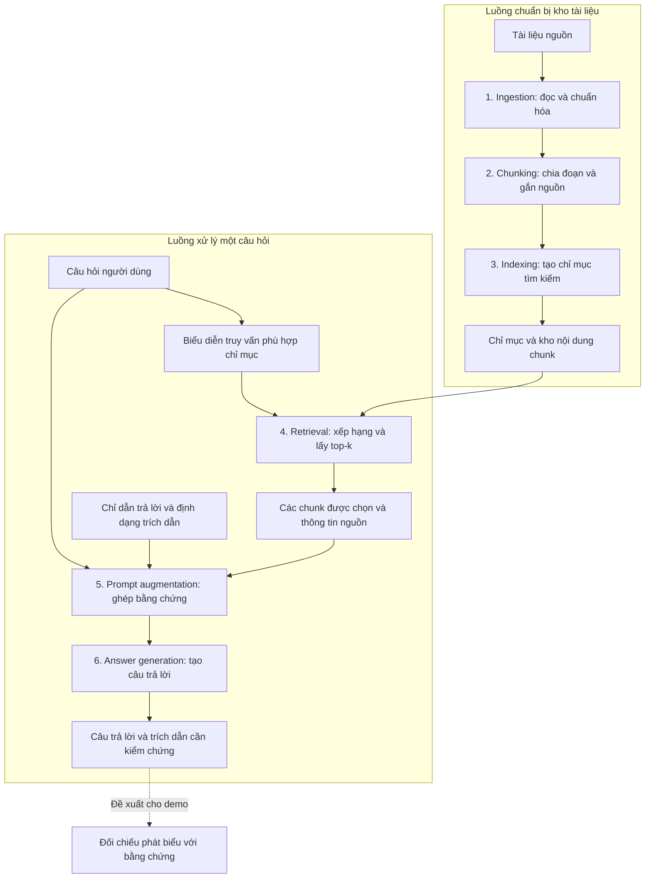

# G1 - Task 4: Phân tích pipeline RAG và các điểm gây lỗi

**Đề tài S07:** Retrieval-Augmented Generation (RAG): Grounding LLM Responses in Documents.

## 1. Mục tiêu và cơ sở phân tích

Pipeline được trình bày theo sáu bước trong đề S07: ingestion, chunking, indexing, retrieval, prompt augmentation và answer generation. Mục tiêu là xác định nhiệm vụ, đầu vào, đầu ra và các điểm gây lỗi của từng bước, đồng thời giải thích cách lỗi ảnh hưởng đến kết quả cuối cùng. [1](<../docs/S07_Seminar_RAG.pdf>)

Lewis và cộng sự (2020) xây dựng RAG bằng cách kết hợp bộ truy hồi với mô hình sinh, sử dụng tài liệu tìm được làm ngữ cảnh cho quá trình tạo đầu ra. Pipeline dưới đây mô tả hệ thống minh họa cho seminar theo yêu cầu đề bài; không đồng nhất mọi lựa chọn triển khai của hệ thống này với kiến trúc và cơ chế huấn luyện trong paper gốc. [2](https://arxiv.org/abs/2005.11401)

Các bảng kiểm tra, ví dụ và biện pháp xử lý trong tài liệu là phân tích thiết kế được đề xuất cho nhóm. Chúng không phải kết quả lỗi đã quan sát từ một hệ thống đang chạy. Các failure cases thực nghiệm sẽ được đối chiếu và bổ sung ở G2.

## 2. Sơ đồ pipeline tổng thể

### 2.1. Sơ đồ Mermaid



**Chú thích:** Nguồn sơ đồ là cách nhóm tổ chức sáu bước theo đề S07, dựa trên ý tưởng truy hồi kết hợp sinh của Lewis và cộng sự. Khối kiểm chứng cuối là đề xuất cho demo. Trích dẫn trong đầu ra không tự chứng minh rằng nội dung đã được kiểm chứng.

### 2.2. Cách đọc sơ đồ

- **Luồng chuẩn bị:** tài liệu nguồn → đọc và chuẩn hóa → chia đoạn → tạo chỉ mục. Chỉ mục và nội dung chunk được giữ lại để dùng cho nhiều câu hỏi.
- **Luồng hỏi đáp:** câu hỏi → truy hồi top-k chunk → ghép câu hỏi, bằng chứng và chỉ dẫn → sinh câu trả lời.
- **Quan hệ giữa hai luồng:** retrieval tìm kiếm trên chỉ mục đã chuẩn bị. Khi tài liệu thay đổi, các chunk và chỉ mục liên quan cần được cập nhật trước khi dùng bản mới để trả lời.

Việc tách khâu chuẩn bị nội dung khỏi xử lý truy vấn cũng được mô tả trong tài liệu kỹ thuật về RAG của Microsoft, bao gồm chia đoạn, tạo biểu diễn tìm kiếm và chuyển kết quả truy hồi sang mô hình sinh. Ở đây chỉ sử dụng cách phân tách chức năng đó; demo không bị ràng buộc phải sử dụng Azure. [3](https://learn.microsoft.com/en-us/azure/search/retrieval-augmented-generation-overview)

## 3. Nhiệm vụ, đầu vào và đầu ra của từng bước

| Bước | Nhiệm vụ | Đầu vào | Đầu ra |
| :--- | :--- | :--- | :--- |
| **1. Ingestion** | Đọc nội dung từ tài liệu, chuẩn hóa văn bản và giữ thông tin xuất xứ. Với PDF quét, cần nhận dạng chữ trước khi xử lý văn bản. | Tài liệu nguồn và thông tin phiên bản. | Văn bản đã trích xuất cùng mã tài liệu, trang/mục và nguồn. |
| **2. Chunking** | Chia văn bản thành các đơn vị có thể tìm kiếm; gắn mã chunk và vị trí trong tài liệu gốc. | Văn bản đã chuẩn hóa. | Tập chunk có nội dung và metadata nguồn. |
| **3. Indexing** | Tạo cấu trúc hoặc biểu diễn để tính mức liên quan giữa câu hỏi và các chunk. | Tập chunk và cấu hình phương pháp tìm kiếm. | Chỉ mục cùng ánh xạ từ mục trong chỉ mục sang nội dung chunk. |
| **4. Retrieval** | Biểu diễn câu hỏi, chấm điểm/xếp hạng các chunk và chọn top-k kết quả. | Câu hỏi, chỉ mục và giá trị k. | Danh sách chunk được xếp hạng, điểm tìm kiếm và metadata. |
| **5. Prompt augmentation** | Tổ chức các chunk thành ngữ cảnh, ghép với câu hỏi và chỉ dẫn trả lời, giữ mã nguồn để hỗ trợ trích dẫn. | Câu hỏi, bằng chứng truy hồi và mẫu chỉ dẫn. | Prompt hoàn chỉnh được gửi cho mô hình sinh. |
| **6. Answer generation** | Tạo câu trả lời từ câu hỏi và ngữ cảnh được cung cấp theo định dạng yêu cầu. | Prompt và mô hình sinh. | Câu trả lời, các mã trích dẫn được mô hình sử dụng hoặc thông báo chưa đủ bằng chứng. |

### 3.1. Những điểm cần làm rõ khi trình bày

**Chunking:** kích thước chunk quyết định lượng thông tin đi cùng một kết quả tìm kiếm. Đoạn quá ngắn có thể mất điều kiện hoặc quan hệ giữa các câu; đoạn quá dài có thể chứa nội dung không phục vụ câu hỏi. Wang và cộng sự (2024) nghiên cứu ảnh hưởng của chunk size, cách chia đoạn, metadata và embedding trong pipeline RAG. Các lựa chọn này cần được kiểm tra trong dữ liệu của nhóm, không có một cấu hình được mặc định tốt nhất cho mọi trường hợp. [4](https://aclanthology.org/2024.emnlp-main.981/)

**Indexing và retrieval:** indexing chuẩn bị cơ chế tìm kiếm; retrieval sử dụng cơ chế đó cho một câu hỏi cụ thể. Đề S07 cho phép dùng TF-IDF/BM25 hoặc cosine similarity giữa embeddings. [1](<../docs/S07_Seminar_RAG.pdf>) Đối với bản triển khai của nhóm, cần kiểm tra tính tương thích của biểu diễn truy vấn và tài liệu: hướng embedding sử dụng các biểu diễn trong cùng không gian tương thích; hướng TF-IDF biến đổi câu hỏi bằng bộ từ vựng và phép biến đổi đã xây từ corpus, không tạo một không gian từ vựng riêng cho từng câu hỏi.

**Prompt và generation:** prompt phải chứa đúng bằng chứng cần dùng, nhưng mô hình vẫn cần được đánh giá sau khi sinh. Giới hạn độ dài đầu vào khiến việc lựa chọn và tổ chức nội dung trở nên cần thiết. [3](https://learn.microsoft.com/en-us/azure/search/retrieval-augmented-generation-overview) RAGTruth cho thấy câu trả lời trong hệ thống RAG vẫn có thể chứa phát biểu không được tài liệu truy hồi hỗ trợ hoặc mâu thuẫn với tài liệu. [5](https://aclanthology.org/2024.acl-long.585/)

## 4. Phân tích failure points theo từng bước

Bảng sau là các tình huống có thể xảy ra và cách nhóm đề xuất kiểm tra chúng. Mỗi hàng thể hiện quan hệ **nguyên nhân → lỗi trung gian → ảnh hưởng đến câu trả lời**.

| Bước | Failure point và nguyên nhân minh họa | Ảnh hưởng đến kết quả | Cách kiểm tra và xử lý đề xuất |
| :--- | :--- | :--- | :--- |
| **Ingestion** | Trích xuất sai số, bỏ sót bảng, ghép sai thứ tự đọc hoặc nhập tài liệu đã hết hiệu lực. | Thông tin đúng không đi vào corpus, hoặc thông tin sai trở thành nguồn cho các bước sau. Mô hình có thể bám sát văn bản đã trích xuất nhưng vẫn trả lời sai so với tài liệu gốc. | Đối chiếu các trang có đáp án với bản gốc; kiểm tra số liệu, bảng và phiên bản; lưu nguồn và ngày hiệu lực. Sửa nội dung trước khi tạo lại chunk/chỉ mục. |
| **Chunking** | Ranh giới chunk tách một kết luận khỏi điều kiện, thời điểm hoặc đối tượng áp dụng. | Retrieval lấy được đoạn chứa từ khóa đáp án nhưng thiếu thông tin cần để diễn giải đúng. | Xem chunk cùng đoạn trước/sau trong tài liệu gốc; giữ tiêu đề và điều kiện liên quan; thử ranh giới theo câu/đoạn hoặc một phần chồng lấn. |
| **Indexing** | Chunk bị bỏ sót, ánh xạ mã chunk sai, chỉ mục chưa cập nhật hoặc biểu diễn truy vấn/tài liệu không tương thích. | Bằng chứng có trong kho văn bản nhưng không thể tìm đúng, hoặc mã nguồn trả về không khớp nội dung. | Kiểm tra số lượng/mã chunk và phiên bản chỉ mục; truy vấn bằng một câu đặc trưng có sẵn trong chunk; xác nhận ánh xạ và cấu hình biểu diễn. |
| **Retrieval** | Câu hỏi diễn đạt khác thuật ngữ trong tài liệu, thiếu ngữ cảnh, hoặc top-k ưu tiên các đoạn cùng chủ đề nhưng sai năm/đối tượng. | Danh sách bằng chứng thiếu hoặc sai thông tin cần trả lời, dù các tài liệu liên quan có thể tồn tại trong chỉ mục. | Đối chiếu top-k với bằng chứng tham chiếu; kiểm tra thứ hạng của chunk đúng; thử cấu hình so sánh đã thống nhất và xem xét metadata phù hợp câu hỏi. |
| **Prompt augmentation** | Chunk đúng được truy hồi nhưng bị bỏ khi ghép prompt, bị cắt ngắn, mất nhãn nguồn hoặc lẫn với thông tin trái ngược mà không có chỉ dẫn xử lý. | Mô hình không nhận đủ bằng chứng; có thể chọn thông tin sai hoặc gắn citation không đúng. | Lưu prompt thực tế sau khi ghép; kiểm tra nội dung và mã nguồn còn đầy đủ; dành chỗ cho phần trả lời; nêu cách xử lý thiếu/mâu thuẫn bằng chứng. |
| **Answer generation** | Mô hình đọc sai điều kiện, suy diễn thêm chi tiết hoặc gắn mã nguồn không hỗ trợ phát biểu. | Câu trả lời có thể sai, thiếu căn cứ hoặc có citation gây hiểu nhầm ngay cả khi prompt chứa bằng chứng đúng. | Đối chiếu từng phát biểu với prompt và tài liệu; kiểm tra nguồn trích dẫn; yêu cầu trả lời trong phạm vi bằng chứng và nhận biết khi chưa đủ thông tin. Các chỉ dẫn này vẫn cần kiểm chứng hiệu quả bằng đầu ra thực tế. |

Lỗi có thể truyền qua nhiều bước hoặc xuất hiện đồng thời. Ví dụ, một câu trả lời sai ngày có thể bắt nguồn từ OCR sai, chọn nhầm phiên bản tài liệu hoặc mô hình đọc sai ngày đúng trong prompt. Vì vậy, không xác định nguyên nhân chỉ từ câu trả lời cuối cùng.

## 5. Ví dụ giả lập xuyên suốt pipeline

**Toàn bộ tên tài liệu, ngày tháng, thứ hạng và đầu ra trong phần này là dữ liệu giả lập để giải thích cơ chế. Đây không phải tài liệu thật, kết quả chạy code hay một failure case thực nghiệm đã được xác nhận.**

### 5.1. Tài liệu và câu hỏi

Giả sử corpus có tài liệu `D1`, tên **Thông báo Workshop AI 2026**, phiên bản năm 2026. Trang 2 có hai đoạn:

> Hạn đăng ký Workshop AI 2026 là 17:00 ngày 15/11/2026. Người tham dự đăng ký qua cổng đăng ký trực tuyến.
>
> Hạn nộp báo cáo sau workshop là ngày 22/11/2026.

**Câu hỏi:** “Hạn đăng ký Workshop AI 2026 là khi nào?”

**Đáp án tham chiếu của ví dụ:** “17:00 ngày 15/11/2026”, với bằng chứng ở trang 2 của `D1`.

### 5.2. Minh họa luồng xử lý đúng

| Bước | Kết quả minh họa |
| :--- | :--- |
| Ingestion | Văn bản giữ đúng giờ, ngày và mục đích của từng hạn; metadata ghi `doc_id=D1`, trang 2, phiên bản 2026. |
| Chunking | `D1.C1` chứa toàn bộ đoạn về hạn đăng ký. `D1.C2` chứa đoạn về hạn nộp báo cáo. Cả hai đều giữ thông tin nguồn. |
| Indexing | Hai chunk được đưa vào chỉ mục; mỗi mục liên kết đúng mã chunk và nội dung. |
| Retrieval | Giả sử top-2 lần lượt là `D1.C1` và `D1.C2`. Thứ hạng này được đặt để minh họa, không phải kết quả đo. |
| Prompt augmentation | Prompt chứa câu hỏi, nội dung hai chunk, nhãn nguồn và chỉ dẫn phân biệt hạn đăng ký với hạn nộp báo cáo. |
| Answer generation | Đầu ra kỳ vọng: “Hạn đăng ký Workshop AI 2026 là 17:00 ngày 15/11/2026 [D1.C1, tr. 2].” |

Một prompt minh họa có thể viết như sau:

```text
Yêu cầu trả lời:
- Chỉ sử dụng bằng chứng bên dưới để trả lời câu hỏi.
- Giữ đúng giờ, ngày và đối tượng áp dụng.
- Gắn mã nguồn tương ứng cho thông tin trả lời.
- Nếu chưa có đủ bằng chứng, nói rõ phần thông tin còn thiếu.

Bằng chứng:
[D1.C1 | Thông báo Workshop AI 2026 | tr. 2 | phiên bản 2026]
Hạn đăng ký Workshop AI 2026 là 17:00 ngày 15/11/2026.
Người tham dự đăng ký qua cổng đăng ký trực tuyến.

[D1.C2 | Thông báo Workshop AI 2026 | tr. 2 | phiên bản 2026]
Hạn nộp báo cáo sau workshop là ngày 22/11/2026.

Câu hỏi:
Hạn đăng ký Workshop AI 2026 là khi nào?
```

Nhãn nguồn trong prompt phải được ứng dụng ánh xạ về đúng tài liệu và vị trí. Mô hình viết ra nhãn `[D1.C1]` chưa đủ; người đánh giá vẫn phải kiểm tra rằng nhãn đó hỗ trợ ngày và giờ trong câu trả lời.

### 5.3. Cùng một câu hỏi nhưng lỗi ở các bước khác nhau

| Tình huống giả lập | Dấu vết cần kiểm tra | Phân tích nguyên nhân |
| :--- | :--- | :--- |
| Văn bản trích xuất ghi `11:00` trong khi PDF gốc ghi `17:00`; câu trả lời dùng `11:00`. | Trang gốc và văn bản ngay sau ingestion. | Lỗi khởi phát ở ingestion. Cần sửa dữ liệu trước khi đánh giá khả năng đọc của mô hình sinh. |
| Chunk được trả về có ngày `15/11/2026` nhưng mất phần giờ; mô hình tự thêm `09:00`. | Ranh giới chunk, nội dung prompt và câu trả lời. | Chunking làm thiếu bằng chứng; việc tự thêm giờ là phát biểu không được prompt hỗ trợ. Có thể ghi nhận nhiều bước góp phần gây lỗi. |
| `D1.C1` có trong tập chunk nhưng bị bỏ sót khi lập chỉ mục. | Danh sách chunk và các mã có trong chỉ mục. | Lỗi indexing khiến retrieval không có cơ hội chọn bằng chứng đúng. |
| Cả hai chunk có trong chỉ mục nhưng retrieval chỉ chọn `D1.C2`; câu trả lời dùng ngày `22/11/2026`. | Top-k và bằng chứng tham chiếu. | Retrieval lấy sai loại hạn; câu trả lời không giải đáp đúng câu hỏi dù ngày xuất hiện trong corpus. |
| Retrieval có `D1.C1`, nhưng prompt chỉ giữ `D1.C2`. | Kết quả retrieval và prompt thực tế gửi đi. | Lỗi prompt augmentation. Không thể chỉ xem danh sách retrieval rồi kết luận mô hình đã nhận được bằng chứng đúng. |
| Prompt giữ đầy đủ cả hai chunk, nhưng mô hình trả lời `22/11/2026` và dẫn `D1.C1`. | Prompt, câu trả lời và nội dung nguồn được dẫn. | Lỗi ở generation: nhầm thông tin và gắn citation không hỗ trợ phát biểu, dù bằng chứng cần thiết đã có trong prompt. |

## 6. Dấu vết cần lưu để xác định nguyên nhân

Nhóm đề xuất lưu các thông tin sau cho mỗi câu hỏi để có thể lần ngược lỗi:

1. Mã câu hỏi, câu hỏi và bằng chứng tham chiếu.
2. Phiên bản corpus, văn bản đã trích xuất và tập chunk.
3. Cấu hình chunking, phương pháp tìm kiếm và giá trị k.
4. Danh sách top-k theo thứ hạng, mã chunk và điểm tìm kiếm.
5. Prompt thực tế gửi cho mô hình, gồm các chunk còn lại sau khi giới hạn độ dài.
6. Câu trả lời, mã trích dẫn và ghi nhận đúng/sai theo bằng chứng.

Điểm truy hồi chỉ là điểm xếp hạng theo phương pháp đang dùng, không tự động là xác suất câu trả lời đúng. Khi dùng điểm để chẩn đoán, cần ghi rõ loại điểm và cấu hình tương ứng.

Nếu câu trả lời sai, trình tự đối chiếu đề xuất là: **tài liệu gốc → văn bản trích xuất → chunk → chỉ mục → top-k → prompt → câu trả lời**. Bước đầu tiên làm mất hoặc làm sai bằng chứng là vị trí cần điều tra trước; các bước sau vẫn có thể có lỗi bổ sung.

## 7. Liên hệ với câu hỏi nghiên cứu và thí nghiệm

Phân tích pipeline cho thấy cần kiểm tra hai điều kiện riêng: bằng chứng đúng có được đưa tới mô hình hay không, và câu trả lời có được bằng chứng hỗ trợ hay không. Điều này trực tiếp phục vụ câu hỏi nghiên cứu đã đặt ở Task 1 về vai trò của tài liệu bên ngoài đối với hallucination.

Trong G2, hit rate hoặc Recall@k được dùng để đánh giá retrieval theo quy ước bằng chứng đã công bố. Những chỉ số đó chưa đánh giá trực tiếp mức độ bám sát nguồn của câu trả lời. Nhóm cần bổ sung đối chiếu đầu ra và trích dẫn nếu có LLM, đồng thời phân tích ít nhất ba lỗi thực tế theo đề S07. [1](<../docs/S07_Seminar_RAG.pdf>)

Nếu không có LLM, nhóm có thể dừng ở kết quả retrieval và prompt minh họa theo phương án đề cho phép. Khi đó, các đầu ra trong phần 5 chỉ là câu trả lời kỳ vọng; không được báo cáo thành kết quả sinh hoặc kết quả đo hallucination.

## Tài liệu tham khảo

1. CS420 - Introduction to Artificial Intelligence. *[S07] Retrieval-Augmented Generation (RAG): Grounding LLM Responses in Documents*. Tài liệu giao seminar, mục II.2, II.4-II.6 và IV. [Đề S07](<../docs/S07_Seminar_RAG.pdf>).
2. Lewis, P., et al. (2020). *Retrieval-Augmented Generation for Knowledge-Intensive NLP Tasks*. NeurIPS 2020. [Paper](https://arxiv.org/abs/2005.11401). Nguồn cho ý tưởng kết hợp bộ truy hồi và mô hình sinh.
3. Microsoft Learn. *Retrieval-augmented generation (RAG) in Azure AI Search*. [Tài liệu kỹ thuật](https://learn.microsoft.com/en-us/azure/search/retrieval-augmented-generation-overview). Tham khảo phần classic RAG, chuẩn bị nội dung và giới hạn ngữ cảnh; không áp đặt dịch vụ Azure cho demo. Truy cập ngày 30/10/2026.
4. Wang, X., et al. (2024). *Searching for Best Practices in Retrieval-Augmented Generation*. Proceedings of EMNLP 2024, 17716-17736. [DOI: 10.18653/v1/2024.emnlp-main.981](https://doi.org/10.18653/v1/2024.emnlp-main.981). Tham khảo phần 3 về các thành phần và lựa chọn thiết kế của workflow, đặc biệt chunking và retrieval.
5. Niu, C., et al. (2024). *RAGTruth: A Hallucination Corpus for Developing Trustworthy Retrieval-Augmented Language Models*. Proceedings of ACL 2024, 10862-10878. [DOI: 10.18653/v1/2024.acl-long.585](https://doi.org/10.18653/v1/2024.acl-long.585). Nguồn bổ sung cho phân tích lỗi sinh câu trả lời trong hệ thống RAG.

**Đối chiếu phân công:** [TASK.md](../docs/TASK.md), G1 - Task 4. Nội dung đặt vấn đề và mục tiêu nằm trong [G1 Task 1](./G1_Task1_Problem_Statement.md).
