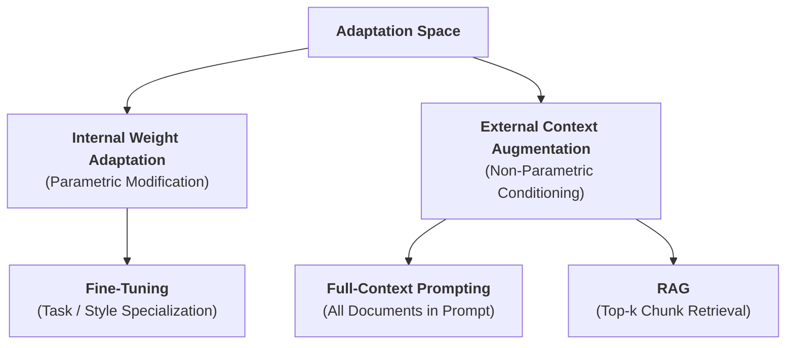
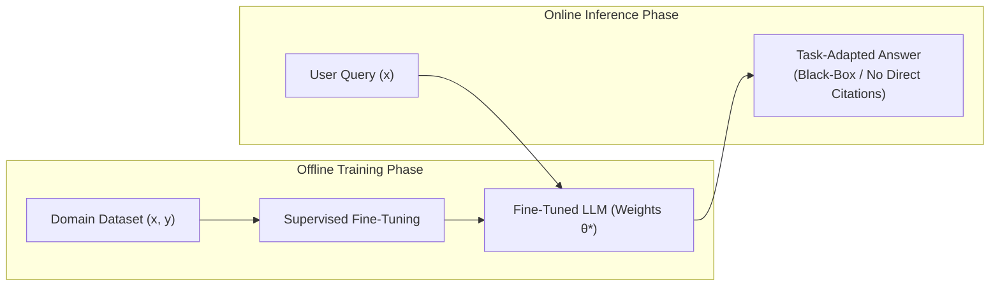
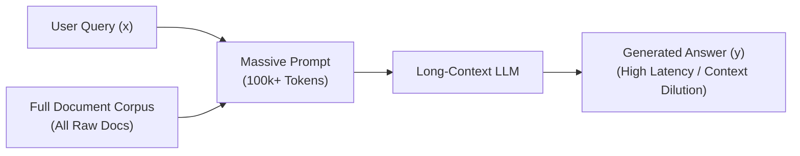
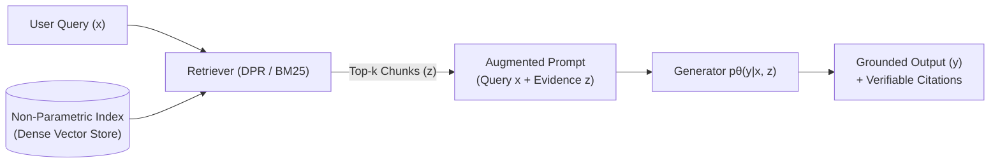

# Task 2: Theoretical Foundations of Retrieval-Augmented Generation (RAG)

> **Course:** CS420 — Introduction to Artificial Intelligence  
> **Seminar Topic:** [S07] Retrieval-Augmented Generation (RAG): Grounding LLM Responses in Documents  
> **Author:** Trịnh Võ Nam Kiệt — `24125013`  
> **Deliverable:** Background Section & Comparative Framework (Parametric vs. Non-parametric Memory, RAG vs. Fine-tuning, RAG vs. Long-context Prompting).

---

## 1. Parametric vs. Non-Parametric Memory in Large Language Models

### 1.1. Conceptual Definitions and Mechanisms
In modern Natural Language Processing (NLP) and Large Language Models (LLMs), knowledge representation and storage are fundamentally categorized into two distinct memory paradigms:

* **Parametric Memory (Internalized Representation):**
  * *Definition:* Knowledge implicitly encoded and compressed into the model's structural parameters (weights $\theta$) during the large-scale pre-training phase.
  * *Operational Mechanism:* When presented with an input sequence $x$, the model activates feed-forward and self-attention pathways to autoregressively infer the probability distribution of the next token $p_\theta(y_t | y_{<t}, x)$ without referencing any external information store.
  * *Foundational Benchmark (Lewis et al., 2020):* Standard pre-trained Sequence-to-Sequence (Seq2Seq) Transformer architectures (e.g., BART-large).
* **Non-Parametric Memory (Externalized Grounding):**
  * *Definition:* Knowledge stored explicitly outside the generative model within an external corpus, vector index, or structured knowledge base.
  * *Operational Mechanism:* Relevant factual evidence $z$ is dynamically retrieved at inference time through a dense or sparse search mechanism (e.g., Maximum Inner Product Search over dense vector embeddings, or BM25/TF-IDF token matching). The non-parametric memory capacity scales independently of model parameters, allowing corpus expansion up to gigabytes or terabytes without re-architecting or retraining the generator.
  * *Foundational Benchmark (Lewis et al., 2020):* A Dense Passage Retrieval (DPR) index comprising 21 million 100-word passages from Wikipedia indexed via FAISS.

---

### 1.2. Comparative Analysis: Parametric vs. Non-Parametric Memory

| Evaluation Dimension | Parametric Memory | Non-Parametric Memory |
| :--- | :--- | :--- |
| **Storage Substrate** | Network parameters $\theta$ (latent, implicit, lossy compression). | External storage / Vector databases (raw text, passage chunks, explicit vectors). |
| **Retrieval Mechanism** | Neural activation across Transformer layers. | Vector similarity search (Cosine, MIPS) or lexical indexing (BM25). |
| **Key Strengths** | - **Low latency:** Fast response generation without external I/O overhead. - **Superior generalization:** High-level linguistic abstraction, syntactic parsing, and commonsense reasoning. - **Pattern recognition:** Captures nuanced correlations and structural dependencies. | - **Factual precision:** Grounds output directly in verifiable primary sources. - **Instant updates (*Index Hot-swapping*):** Knowledge base can be updated, inserted, or purged instantly without retraining. - **Scalability:** Corpus size scales up to terabytes without increasing generator size. |
| **Key Limitations** | - **Catastrophic forgetting:** Learning new information risks degrading prior knowledge. - **Capacity ceiling:** Memory bounds are strictly limited by model parameter size. - **Static / Knowledge cutoff:** Updating requires expensive retraining or fine-tuning. | - **Latency overhead:** External search introduces additional inference latency. - **Retrieval bottleneck:** System accuracy is upper-bounded by retriever recall and precision. - **Infrastructure footprint:** Requires dedicated memory (RAM/Disk) for dense vector indexes. - **Multi-hop difficulty:** Struggles when synthesizing facts fragmented across distant passages. |
| **Optimal Use Cases** | General NLP tasks, machine translation, creative text generation, stylistic adaptation, abstract reasoning, and standardized linguistic conventions. | Knowledge-intensive NLP tasks (open-domain QA, fact verification), proprietary enterprise data, time-sensitive information (news, financial reports, regulations). |
| **Representative Example** | Translating a paragraph from English to French; summarizing narrative text. | Querying the latest university enrollment regulations for Semester 2, 2024. |

---

### 1.3. Relationship with Hallucinations and the Guiding Research Question

> **Guiding Question:** *Does providing external documents eliminate hallucinations in language models?*

#### Formal Definition of Hallucination
In generative language models, **hallucination** denotes the phenomenon where the model generates content that is nonsensical, factually incorrect, or unsupported by real-world knowledge or provided source context—often articulated with high syntactic confidence and fluency.

#### Mechanistic Role of Both Memory Paradigms
1. **Parametric Memory as the Source of Hallucination:**
   * Pre-training compresses petabytes of text into fixed-dimension weights, acting as a **lossy compression** channel.
   * For tail entities, low-frequency facts, or post-cutoff world states, the model lacks sufficient parametric evidence. Because its objective is token-level likelihood maximization rather than factuality verification, it defaults to plausibility-driven confabulation.
2. **Non-parametric Memory as Grounding Constraint:**
   * External retrieval supplies authoritative evidence $z$ directly into the conditioning prompt, converting an *open-ended generation* task into a *conditional machine reading comprehension* task.
   * This substantially **mitigates** hallucinations and enables provenance tracing (source citation).

#### Resolution to the Guiding Question
**Providing external documents does NOT eliminate hallucinations.** While RAG significantly suppresses ungrounded generations, empirical and theoretical findings reveal that hallucinations persist due to three distinct failure modes:
1. **Retrieval Failure:** The retriever fails to fetch the relevant chunk, retrieves false positives (irrelevant passages), or retrieves noisy/conflicting context. The generator either absorbs the misinformation or falls back to its stale parametric memory.
2. **Faithfulness / Attribution Failure (*Generation Beyond Evidence*):** Even when supplied with gold evidence, the generator may ignore the retrieved context due to strong prior parametric bias, or extrapolate speculative assertions unsupported by the text.
3. **Reasoning / Synthesis Failure:** The retrieved evidence contains the correct facts, but the model misinterprets logical relationships (e.g., temporal causality, negation, or entity-attribute binding).

---

## 2. Distinguishing RAG from Alternative Adaptation Paradigms

### 2.1. RAG vs. Fine-Tuning

| Evaluation Metric | Retrieval-Augmented Generation (RAG) | Fine-Tuning (Full / PEFT) |
| :--- | :--- | :--- |
| **Technical Mechanism** | Couples parametric weights $\theta$ with external non-parametric index $z$ at inference. | Modifies neural parameters ($\theta \to \theta^*$) via gradient descent over task data. |
| **Primary Objective** | Injects dynamic factual knowledge, provides evidence grounding and citations. | Teaches domain-specific task formats, linguistic style, tone, and specific behavioral priors. |
| **Knowledge Freshness** | **Instantaneous (*Index Hot-swapping*):** New knowledge is indexed without model downtime or retraining. | **Periodic & Expensive:** Any factual update requires curated dataset generation and re-training. |
| **Verifiability (Provenance)** | **High (Auditable):** Model outputs can be directly cited and traced back to specific source passages. | **Low (Black-Box):** Learned knowledge is entangled across billions of floating-point weights. |
| **Hallucination Control** | Highly effective for factual question answering by enforcing adherence to retrieved context. | Prone to memorization errors and persistent hallucination on factual queries. |
| **Computational Cost** | Low training compute (retriever/generator can be frozen); inference cost scales with retrieval and prompt length. | High training compute (GPU hours, checkpoint storage); lower per-inference latency (shorter prompt). |
| **When to Apply** | Dynamic information domains, verifiable QA, enterprise knowledge search, strict regulatory compliance. | Fixed formatting requirements (JSON, SQL generation), stylistic alignment, niche vocabularies. |

> **Recommended Synergy:** Industry best practices frequently combine both: Fine-tune the LLM to adhere strictly to context and follow citation formatting, then deploy RAG to feed current, verifiable domain facts.

---

### 2.2. RAG vs. Long-Context Prompting (Full-Document Context)

With recent advancements in models supporting massive context windows (e.g., 1M+ tokens in Gemini 1.5, Claude 3), placing entire raw document collections directly into the prompt has emerged as an alternative.

| Metric | Long-Context Prompting (Full Document in Context) | RAG (Selective Top-$k$ Retrieval) |
| :--- | :--- | :--- |
| **Operational Workflow** | Concatenates the entire raw corpus into the prompt for a single LLM forward pass. | Deconstructs text into chunks, builds index, retrieves $k$ most relevant passages. |
| **Token Consumption & Cost** | **Prohibitive:** Every query re-processes hundreds of thousands of tokens, scaling linear query costs steeply. | **Economical:** Each query consumes tokens only for $k$ relevant chunks (hundreds to low thousands). |
| **Inference Latency** | **High:** Time-to-First-Token (TTFT) increases significantly due to quadratic/linear attention computation over massive sequences. | **Low:** LLM processes a compact context; total retrieval overhead is minimal (tens of milliseconds). |
| **"Lost in the Middle" Degradation** | **Severe:** Models tend to access facts at the extreme beginning or end of long contexts, frequently missing needles in the middle (Liu et al., 2023). | **Mitigated:** Only dense relevant passages are concentrated into the immediate attention span. |
| **Corpus Scalability** | **Hard bounded:** Constrained by maximum context limits (cannot scale to millions of pages or entire web corpuses). | **Virtually Unbounded:** Vector indexes easily scale to billions of documents via Approximate Nearest Neighbor (ANN) search. |
| **Engineering Complexity** | **Minimal:** Requires no chunking, embedding models, vector databases, or rerankers. | **Moderate to High:** Requires ingestion pipelines, chunk tuning, similarity thresholds, and rerankers. |
| **Applicability** | Single long-document analysis (e.g., a single book, legal contract, or code repository audit). | Multi-document organizational search, institutional knowledge bases, real-time question answering. |

---

## 3. Comparative Architectural Diagrams

The architectural workflows below illustrate the data-flow divergence across the four core adaptation paradigms:

### 3.1. Paradigm 1: Parametric Zero-Shot (Frozen Pre-trained LLM)
In this baseline configuration, the generative model relies solely on its internal weights $\theta$ acquired during pre-training, without any external context augmentation or task-specific parameter fine-tuning.

---

### 3.2. Paradigm 2: Supervised Fine-Tuning (Parametric Model Adaptation)
Domain-specific knowledge and stylistic formatting are internalized into modified network weights $\theta^*$ through gradient descent on a curated training dataset $(x, y)$.

---

### 3.3. Paradigm 3: Long-Context Prompting (Full-Document in Context)
The entire uncurated corpus is appended directly into the prompt alongside the query. While it requires no index infrastructure, it triggers high token consumption, substantial latency, and susceptibility to the "Lost in the Middle" phenomenon.

---

### 3.4. Paradigm 4: Retrieval-Augmented Generation (RAG)
RAG decouples knowledge storage from the neural generator by dynamically fetching top-$k$ relevant passages $z$ from an external non-parametric vector index at inference time, injecting them as grounded evidence into the generator prompt.

---

## 4. Comprehensive Comparison Matrix

| Evaluation Dimension | Parametric Zero-Shot | Fine-Tuning | Long-Context Prompting | RAG |
| :--- | :---: | :---: | :---: | :---: |
| **Knowledge Substrate** | Static Weights $\theta$ | Updated Weights $\theta^*$ | Direct Context Input | Hybrid: Weights $\theta$ + External $z$ |
| **Knowledge Freshness** | None (Static cutoff) | Slow & Expensive (Retrain) | Immediate (Prompt file swap) | **Immediate (*Index Hot-swapping*)** |
| **Query Computational Cost** | Lowest | Low | Extremely High | Low to Moderate |
| **Inference Latency (TTFT)** | Fast | Fast | Slow | Fast to Moderate |
| **"Lost in the Middle" Risk** | N/A | N/A | Critical | **Minimal (Focused Top-$k$)** |
| **Corpus Scalability** | Fixed | Fixed | Bounded by Context Window | **Virtually Unbounded** |
| **Evidence Provenance / Citation** | Low (Black-box) | Low (Black-box) | Moderate | **Explicit & Verifiable** |
| **Hallucination Mitigation** | Worst | Moderate | Good | **Best** |

---

## 5. References

1. **Lewis, P., Perez, E., Piktus, A., Petroni, F., Karpukhin, V., Goyal, N., Küttler, H., Lewis, M., Yih, W., Rocktäschel, T., Riedel, S., & Kiela, D. (2020).** Retrieval-Augmented Generation for Knowledge-Intensive NLP Tasks. *Advances in Neural Information Processing Systems (NeurIPS 2020)*, 33, 9459–9474.
2. **Schneider, J. (2024).** Explainable Generative AI (GenXAI): a survey, conceptualization, and research agenda. *Artificial Intelligence Review*, 57(11), 289.
3. **Liu, N. F., Lin, K., Hewitt, J., Paranjape, A., Bevilacqua, M., Petroni, F., & Liang, P. (2023).** Lost in the Middle: How Language Models Use Long Contexts. *Transactions of the Association for Computational Linguistics (TACL)*, 12, 157–173.
4. **Karpukhin, V., Oğuz, B., Min, S., Lewis, P., Wu, L., Edunov, S., Chen, D., & Yih, W. (2020).** Dense Passage Retrieval for Open-Domain Question Answering. *Proceedings of the 2020 Conference on Empirical Methods in Natural Language Processing (EMNLP 2020)*, 6769–6781.
