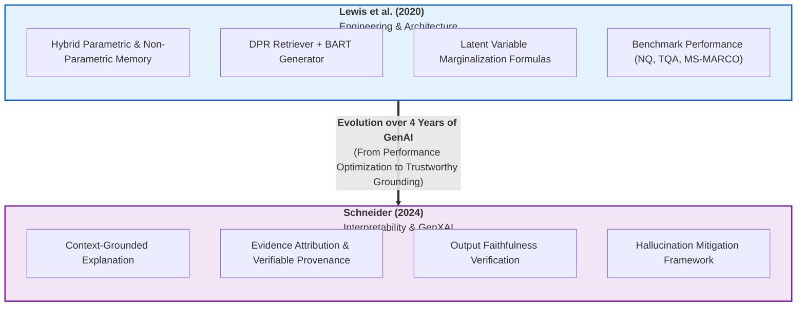

# Task 3: Research Paper Synthesis & Literature Review

> **Course:** CS420 — Introduction to Artificial Intelligence  
> **Seminar Topic:** [S07] Retrieval-Augmented Generation (RAG): Grounding LLM Responses in Documents  
> **Author:** Trịnh Võ Nam Kiệt — `24125013`  
> **Deliverable:** Paper Synthesis Matrix & Literature Review (Lewis et al., 2020 & Schneider, 2024).

---

## 1. Executive Paper Synthesis Matrix

The table below synthesizes the foundational paper by **Lewis et al. (2020)** and the recommended survey by **Schneider (2024)** across key research dimensions:

| Dimension | Mandatory Paper: Lewis et al. (2020) | Recommended Paper: Schneider (2024) |
| :--- | :--- | :--- |
| **Title** | *Retrieval-Augmented Generation for Knowledge-Intensive NLP Tasks* | *Explainable Generative AI (GenXAI): a survey, conceptualization, and research agenda* |
| **Venue / Year** | NeurIPS 2020 | Artificial Intelligence Review (Springer), 2024 |
| **Core Objective** | Develop a hybrid end-to-end differentiable generation model coupling parametric memory (BART) with non-parametric dense retrieval (DPR). | Establish a foundational taxonomy, conceptualization, and research agenda for Explainable Generative AI (GenXAI). |
| **Primary Methodology** | Probabilistic latent-variable modeling (RAG-Sequence & RAG-Token marginalization over top-$k$ documents), empirical benchmark evaluation. | Multi-disciplinary meta-survey, conceptual framework derivation across 4 foundational XAI sources, qualitative taxonomy mapping. |
| **Major Contributions** | 1. Formalized RAG-Sequence and RAG-Token formulations. 2. Demonstrated that non-parametric memory enables zero-training factual updates (*index hot-swapping*). 3. Achieved state-of-the-art results across 4 open-domain QA datasets without task-specific pipelines. | 1. Defined GenXAI and distinguished it from pre-GenAI XAI paradigms. 2. Conceptualized RAG as an external-grounding XAI technique providing evidence attribution and verifiability. 3. Formulated a 10-point research roadmap targeting hallucinations, mechanistic interpretability, and interaction. |
| **Key Findings** | - Hybrid parametric/non-parametric models match or exceed massive closed-book models (e.g., T5-11B) with far fewer trainable parameters. - RAG models generate more diverse, specific, and factually grounded text than parametric-only BART. - RAG can answer correctly even when the gold passage is absent (11.8% accuracy on NQ). | - Pre-GenAI XAI techniques (SHAP, LIME) are computationally and semantically inadequate for autoregressive text generation. - Grounding generations in external sources (RAG) is paramount for verifiability and combating hallucinations. - Self-explanations (CoT) frequently lack faithfulness, necessitating external evidence attribution. |
| **Limitations / Unresolved Issues** | - Assumes retrieved passages are mutually independent in top-$k$ marginalization. - Lacks explicit attribution metrics: answers can be factually correct while citing irrelevant passages (unfaithful grounding). | - Conceptual survey without novel quantitative benchmarks or empirical algorithmic validation. - Focuses primarily on text and vision modalities, leaving emerging multimodal formats less explored. |
| **Role in Seminar Project** | Provides the core mathematical equations, architectural blueprints, and benchmark baselines for RAG modeling. | Supplies the theoretical foundation for Explainability, Evidence Attribution, and Failure Verification mechanisms. |

---

## 2. In-Depth Synthesis: Lewis et al. (2020)

### 2.1. Research Context and Problem Statement
Prior to Lewis et al. (2020), large pre-trained language models stored factual knowledge purely in their parametric weights. While these "closed-book" models demonstrated remarkable fluency, they suffered from three fundamental drawbacks:
1. **Inability to expand or update memory dynamically:** Updating world knowledge required full retraining or parameter-intensive fine-tuning.
2. **Opacity of predictions:** Models could not natively provide audit trails or inspectable citations for their generated assertions.
3. **Pervasive hallucinations:** When parametric memory lacked specific factual details, models defaulted to statistically plausible confabulation.

While hybrid models combining parametric and non-parametric memory existed (e.g., REALM, DPR), they were strictly limited to **extractive downstream tasks** (extracting exact spans from retrieved text). Lewis et al. generalized this hybrid paradigm to general-purpose **sequence-to-sequence (Seq2Seq) generation**.

---

### 2.2. Architectural Formulations: Sequence-Level vs. Token-Level Conditioning
Lewis et al. treated the retrieved passage $z$ as a latent variable and introduced two distinct marginalization paradigms to couple retrieval with autoregressive generation:
* **RAG-Sequence (Sequence-Level Marginalization):** Assumes a single retrieved passage $z$ generates the entire output sequence $y$, computing $p(y \mid x) \approx \sum_{z \in \text{top-}k} p_\eta(z \mid x) p_\theta(y \mid x, z)$. This enforces global document coherence but requires specialized multi-beam search algorithms (*Thorough/Fast Decoding*).
* **RAG-Token (Token-Level Marginalization):** Marginalizes over the latent documents at every token emission step: $p(y \mid x) \approx \prod_{i=1}^N \sum_{z \in \text{top-}k} p_\eta(z \mid x) p_\theta(y_i \mid x, z, y_{1:i-1})$. This allows the generator to synthesize distinct facts across multiple passages and integrates directly into standard autoregressive beam search.

*(For full mathematical derivations, variable specifications, and worked step-by-step numerical examples, refer to [TASK_5.md](TASK_5.md)).*

---

### 2.3. Key Findings and Quantitative Benchmark Results
1. **Open-Domain Question Answering (NQ, TriviaQA, WebQuestions, CuratedTrec):**
   * RAG established new state-of-the-art results, outperforming both extractive systems (DPR) and massive parametric models (T5-11B + SSM), despite having far fewer parameters.
   * RAG-Sequence achieved **44.5%** on Natural Questions (vs. 41.5% for DPR and 36.6% for T5-11B+SSM).
2. **Abstractive Question Answering (Open MS-MARCO):**
   * RAG-Sequence outperformed pure BART by **2.6 BLEU** and **2.6 ROUGE-L** points.
   * Human evaluation confirmed RAG generations were significantly less prone to hallucination and substantially more factually grounded.
3. **Jeopardy Question Generation:**
   * RAG-Token outperformed RAG-Sequence, demonstrating superior ability to synthesize distinct facts from multiple documents into a single coherent clue.
4. **Index Hot-Swapping:**
   * The authors demonstrated that replacing the 2016 Wikipedia index with a 2018 index allowed RAG to answer updated world-knowledge queries without retraining a single parameter.

---

## 3. In-Depth Synthesis: Schneider (2024) — GenXAI

### 3.1. Research Context: The Generative AI Black-Box Crisis
Johannes Schneider (2024) highlights that the emergence of Foundation Models has fundamentally shifted AI:
* **The Inadequacy of Pre-GenAI XAI:** Classical explainability methods relied on simple classification settings with fixed labels. Feature attribution methods (such as SHAP or LIME) become computationally intractable and semantically meaningless when applied to long, unstructured text outputs.
* **The Need for Conceptualization:** GenAI introduces novel failure surfaces—primarily hallucinations, privacy leakage, and sycophancy—requiring a specialized discipline: **Explainable Generative AI (GenXAI)**.

---

### 3.2. Taxonomy of GenXAI and Foundational Sources
Schneider categorizes GenXAI techniques across four foundational sources from which explanations originate:
1. **Training Data:** Leveraging data attribution (e.g., influence functions, data modeling) to identify training samples that induced specific model behaviors.
2. **Model Parameters / Architectures:** Probing internal latent representations and applying **Mechanistic Interpretability** (identifying specific circuits, induction heads, and factual "knowledge neurons").
3. **Optimization Objectives:** Analyzing how loss formulations, regularization, and alignment methods (RLHF, DPO) constrain model generation.
4. **Prompts & Context Grounding:** Using Chain-of-Thought (CoT) prompting, in-context learning, and **Retrieval-Augmented Generation (RAG)** to condition model outputs on inspectable, external evidence.

---

### 3.3. Key Emphasis: Schneider's Classification of RAG under "Prompt & Context Grounding"
A central conceptual contribution in Schneider (2024) is the formal classification of **Retrieval-Augmented Generation (RAG)** into the category of **Prompt- and Context-Grounded XAI**:

> **Core Theoretical Insight:** Schneider establishes that RAG is not merely an engineering trick to boost QA accuracy, but a **first-class Explainable AI mechanism**. By dynamically retrieving external documents and feeding them into the prompt, RAG fundamentally alters the explainability landscape:

1. **Radical Bounding of the Explanatory Scope:** While an LLM's pre-training corpus is an opaque, multi-terabyte "black box," the non-parametric context supplied via RAG is compact, explicit, and human-readable. The explanation search space shrinks from trillions of unknown training tokens to a few thousand explicit context tokens.
2. **Explainability under Black-Box Model Access:** Modern state-of-the-art LLMs (e.g., GPT-4o, Claude 3.5, Gemini 1.5) are accessible exclusively via black-box APIs, completely blocking white-box methods like gradient attribution or internal activation probing. Prompt-based context grounding (RAG) is one of the very few explainability mechanisms that functions effectively under strict black-box constraints.
3. **Evidence Attribution and Auditability (*Provenance*):** RAG forces the model's factual assertions to be tethered to specific source snippets, enabling humans and automated checkers to verify correctness (*verifiability*).
4. **The "Attribution Hallucination" Caveat:** Schneider explicitly warns that citing an external source does not automatically guarantee truthfulness. A model can emit an unfaithful citation that points to an irrelevant passage while still answering correctly via parametric bias, or fabricate facts beyond the retrieved evidence. This motivates the necessity of rigorous post-generation verification.

---

### 3.4. Schneider's 10-Point Research Agenda for GenXAI (Brief Overview)
Schneider highlights 10 critical avenues to guide the future of Explainable Generative AI:

1. **Multi-turn Interactions:** Explaining dynamic, multi-turn conversational workflows rather than isolated single-turn input-output pairs.
2. **Real-time & Interactive XAI:** Enabling adaptive, on-the-fly explanations refined through live user feedback and interactive probing.
3. **Multimodal GenXAI:** Developing unified frameworks that explain cross-modal reasoning (e.g., text-to-image, video-to-text).
4. **Novel Generative Modalities:** Extending explainability to emerging frontiers like 3D asset generation, video synthesis, and embodied agents.
5. **Mechanistic Interpretability:** Reverse-engineering internal circuits, attention heads, and "knowledge neurons" into human-understandable algorithms.
6. **★ Verifiability & Hallucinations (Core for RAG):** Mitigating hallucinations through external evidence grounding (RAG), attribution tracing, and automated consistency verification.
7. **Scaling Classical XAI:** Adapting computationally heavy pre-GenAI methods (e.g., SHAP, Integrated Gradients) to billion-parameter foundation models.
8. **Personalized Explanations:** Tailoring explanation depth, vocabulary, and cognitive load to diverse user profiles and expertise levels.
9. **Sample Difficulty & Reflection:** Dynamically adjusting explanation compute and depth based on query complexity (*"thinking fast vs. slow"*).
10. **Complex Generative Outputs:** Establishing evaluation metrics suited for free-form, multifaceted text/media rather than rigid scalar classification scores.

---

## 4. Conceptual Bridging: Connecting Lewis et al. (2020) to Schneider (2024)

The convergence of Lewis et al. and Schneider reveals a crucial evolution in AI research:

1. **From Performance Optimization to Trustworthy Grounding:**
   * Lewis et al. treated the non-parametric index primarily as an informational supplement to maximize exact match scores.
   * Schneider reframes external retrieval as an **epistemic anchor** that renders generative outputs transparent, contestable, and verifiable.
2. **Exposing the "Faithfulness Gap":**
   * Lewis et al. noted that RAG achieved 11.8% accuracy on Natural Questions even when the answer passage was absent from the retrieved top-$k$ docs.
   * Under Schneider's framework, this finding represents a double-edged sword: while it highlights the robustness of parametric memory, it also exposes the **faithfulness gap**—the model can emit ungrounded statements that appear grounded, misleading the user.
3. **Theoretical Justification for RAG Evaluation Frameworks:**
   * Schneider's emphasis on output verification directly motivates modern evaluation frameworks (e.g., Ragas, TruLens) that decompose RAG evaluation into:
     - **Context Relevance:** Precision of the non-parametric retriever.
     - **Faithfulness / Groundedness:** Adherence of the generator to the retrieved evidence.
     - **Answer Relevance:** Direct alignment between generated output and user prompt.

---

## 5. Demarcation: Literature Findings vs. Team Experimental Scope

To adhere to the rigorous research standards of CS420, the table below explicitly delineates the findings established by prior literature from the empirical scope to be conducted by our project team:

| Aspect | Established Literature (Lewis et al. / Schneider) | Team Seminar Scope (G2 Implementation) |
| :--- | :--- | :--- |
| **Corpus Scale & Domain** | English Wikipedia dump (21 million 100-word passages; ~13 GB index). | **[Completed - G2 Task 1]** Curated Vietnamese Institutional Corpus (51 pages across 4 official HCMUS documents: academic regulations, student conduct evaluation, tuition policy, and English graduation requirements). |
| **Benchmark Set & Ground Truth** | Standardized open-domain QA benchmarks (Natural Questions, TriviaQA, CuratedTrec, WebQuestions). | **[Completed - G2 Task 2]** Curated benchmark of 20 reference questions paired with reference answers and 30 verified page-level evidence spans. |
| **Retriever Architecture** | Pre-trained dense bi-encoder (DPR) with 768-dim embeddings, optimized via MIPS/FAISS. | **[Required by Seminar Assignment - S07 PDF]** Lightweight retrieval evaluating TF-IDF/BM25 vs. embedding-based Cosine Similarity; comparing at least two chunk sizes or values of $k$ *(Specific embedding model & index implementation: **[TBD]**)*. |
| **Generator Model** | BART-large (400M parameters, pre-trained seq2seq Transformer). | **[Required by Seminar Assignment - S07 PDF]** If an LLM is available, compare answers with vs. without retrieval; otherwise demonstrate prompt evidence insertion *(Specific LLM selection: **[TBD]**)*. |
| **Evaluation Metrics** | Exact Match (EM), F1, BLEU, ROUGE-L on standardized open-domain benchmarks. | **[Required by Seminar Assignment - S07 PDF]** Top-$k$ Hit Rate and Recall@$k$ across at least two chunk sizes or values of $k$ *(Quantitative evaluation results: **[TBD]**)*. |
| **Failure Analysis** | Focused on accuracy drops when gold passages are absent; human preference evaluation. | **[Required by Seminar Assignment - S07 PDF]** Empirical categorization and analysis of at least 3 distinct failure cases: missing retrieval, incorrect retrieved documents, and generation beyond evidence *(Concrete failure cases: **[TBD]**)*. |
| **Verification & Update Mechanisms** | Conceptual identification of evidence citation benefits (Schneider). | **[Required by Seminar Assignment - S07 PDF]** Proposed verification mechanisms (evidence attribution checking) and document-update strategies (*Index hot-swapping* / CDC) *(Specific verification workflow: **[TBD]**)*. |

---

## 6. References

1. **Lewis, P., Perez, E., Piktus, A., Petroni, F., Karpukhin, V., Goyal, N., Küttler, H., Lewis, M., Yih, W., Rocktäschel, T., Riedel, S., & Kiela, D. (2020).** Retrieval-Augmented Generation for Knowledge-Intensive NLP Tasks. *Advances in Neural Information Processing Systems (NeurIPS 2020)*, 33, 9459–9474.
2. **Schneider, J. (2024).** Explainable Generative AI (GenXAI): a survey, conceptualization, and research agenda. *Artificial Intelligence Review*, 57(11), 289.
3. **Karpukhin, V., Oğuz, B., Min, S., Lewis, P., Wu, L., Edunov, S., Chen, D., & Yih, W. (2020).** Dense Passage Retrieval for Open-Domain Question Answering. *Proceedings of the 2020 Conference on Empirical Methods in Natural Language Processing (EMNLP 2020)*, 6769–6781.
4. **Liu, N. F., Lin, K., Hewitt, J., Paranjape, A., Bevilacqua, M., Petroni, F., & Liang, P. (2023).** Lost in the Middle: How Language Models Use Long Contexts. *Transactions of the Association for Computational Linguistics (TACL)*, 12, 157–173.
