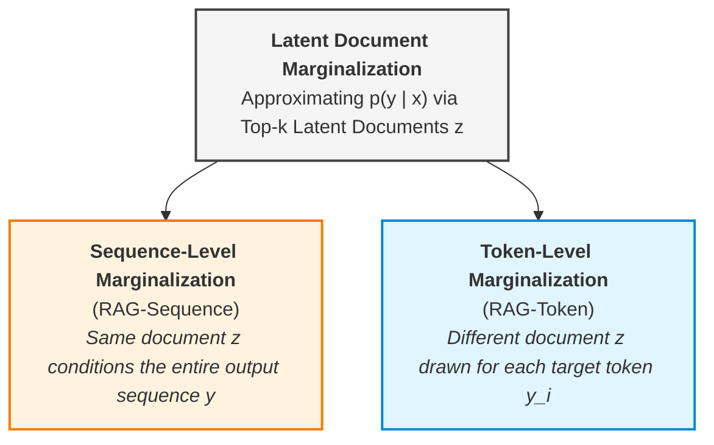
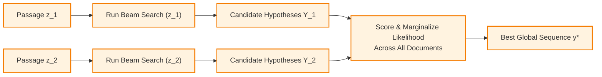
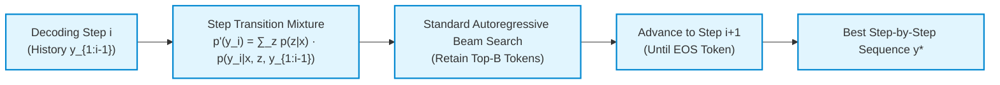

# Task 5: Mathematical Formulation, Algorithmic Analysis, and Worked Example for RAG Models

> **Course:** CS420 — Introduction to Artificial Intelligence  
> **Seminar Topic:** [S07] Retrieval-Augmented Generation (RAG): Grounding LLM Responses in Documents  
> **Author:** Trịnh Võ Nam Kiệt — `24125013`  
> **Deliverable:** Mathematical Equation Explanation, Variable Definitions, Modeling Assumptions, and Step-by-Step Worked Numerical Example (RAG-Sequence vs. RAG-Token).

---

## 1. Mathematical Foundations & Probabilistic Formulations

In the foundational formulation of Retrieval-Augmented Generation (Lewis et al., 2020), the external retrieved document $z$ is treated as a **latent variable**. To generate the final output sequence $y$ given an input query $x$, the model marginalizes over the latent document distribution. Lewis et al. proposed two distinct probabilistic formulations that marginalize over latent documents in different ways: **RAG-Sequence** and **RAG-Token**.

---

### 1.1. The RAG-Sequence Model
The **RAG-Sequence** model assumes that a **single retrieved document $z$ is responsible for generating the entire target sequence $y$**. The latent document $z$ is marginalized at the sequence level:

$$p_{\text{RAG-Sequence}}(y \mid x) \approx \sum_{z \in \text{top-}k(p(\cdot \mid x))} p_\eta(z \mid x) \cdot p_\theta(y \mid x, z)$$

Expanding the autoregressive probability of the generator $p_\theta(y \mid x, z)$ using the probability chain rule yields:

$$p_{\text{RAG-Sequence}}(y \mid x) \approx \sum_{z \in \text{top-}k(p(\cdot \mid x))} p_\eta(z \mid x) \prod_{i=1}^N p_\theta(y_i \mid x, z, y_{1:i-1})$$

*Operational Mechanism:* The retriever first selects the top-$k$ candidate documents. For each individual document $z$, the generator produces the complete conditional likelihood of the entire sequence $\prod_{i=1}^N p_\theta(y_i \mid x, z, y_{1:i-1})$. Finally, the model computes the expected sequence probability as a weighted sum over the document priors $p_\eta(z \mid x)$.

---

### 1.2. The RAG-Token Model
The **RAG-Token** model relaxes the single-document constraint by allowing **each token $y_i$ in the output sequence to be drawn from a different latent document $z$**. The latent document is marginalized at each individual generation step:

$$p_{\text{RAG-Token}}(y \mid x) \approx \prod_{i=1}^N \sum_{z \in \text{top-}k(p(\cdot \mid x))} p_\eta(z \mid x) \cdot p_\theta(y_i \mid x, z, y_{1:i-1})$$

*Operational Mechanism:* At each autoregressive decoding step $i$, the model computes a mixture distribution over the next token by taking the weighted sum across all top-$k$ documents using their prior weights $p_\eta(z \mid x)$. The full sequence probability is the product of these step-wise marginal token probabilities.

---

## 2. Variable Definitions, Value Ranges, and Physical Units

The table below provides a rigorous specification of every symbol, its role within the RAG architecture, its mathematical domain, and its unit of measurement:

| Symbol | Architectural Role / Definition | Value Range (Domain) | Appropriate Unit |
| :--- | :--- | :--- | :--- |
| $x$ | Input query sequence (user question or instruction prompt). | Sequence of discrete tokens: $x \in \mathcal{V}^*$ | Tokens |
| $y$ | Output target sequence: $y = [y_1, y_2, \dots, y_N]$. | $y \in \mathcal{V}^N$ (or generally $y \in \mathcal{V}^*$ with sequence length $N \ge 1$, each $y_i \in \mathcal{V}$) | Tokens |
| $z$ | Latent retrieved passage/document from external non-parametric corpus $\mathcal{Z}$. | Text passage: $z \in \mathcal{Z}$ (Wikipedia corpus) | Passage |
| $\text{top-}k(p(\cdot \mid x))$ | Set of $k$ documents with highest prior retrieval probability. | Discrete subset of size $k \in \mathbb{Z}^+$ ($k \in \{5, 10, 15, 50\}$) | Dimensionless count |
| $\eta$ | Trainable parameters of the Dense Passage Retriever (DPR query encoder $\text{BERT}_q$). | Continuous parameter space: $\eta \in \mathbb{R}^{d_{\text{ret}}}$ | Model weights |
| $\theta$ | Trainable parameters of the generative model (BART-large Seq2Seq Transformer). | Continuous parameter space: $\theta \in \mathbb{R}^{d_{\text{gen}}}$ (~400M params) | Model weights |
| $p_\eta(z \mid x)$ | Prior retrieval probability of passage $z$ given query $x$, parameterized by $\eta$. | $[0, 1]$, constrained by $\sum_{z \in \text{top-}k} p_\eta(z \mid x) \le 1$ | Dimensionless probability |
| $p_\theta(y \mid x, z)$ | Sequence generation probability under a single passage $z$, parameterized by $\theta$. | $[0, 1]$, where $\sum_{y' \in \mathcal{Y}} p_\theta(y' \mid x, z) = 1$ | Dimensionless probability |
| $p_\theta(y_i \mid x, z, y_{1:i-1})$ | Conditional probability of emitting token $y_i$ given context $x$, passage $z$, and past tokens. | $[0, 1]$, where $\sum_{v \in \mathcal{V}} p_\theta(v \mid x, z, y_{1:i-1}) = 1$ | Dimensionless probability |
| $p(y \mid x)$ | Marginalized likelihood of generating sequence $y$ given input query $x$. | $[0, 1]$ | Dimensionless probability |

> **Numerical Log-Space Representation:** In computational implementations and gradient optimization (negative marginal log-likelihood loss $\mathcal{L} = -\sum_j \log p(y_j \mid x_j)$), probabilities are manipulated in logarithmic space: $\log p(y \mid x) \in (-\infty, 0]$. The logarithmic unit is expressed in **nats** (natural log base $e$) or **bits** (log base 2).

### Inner Parametrization of Subsystems (Lewis et al., 2020)
1. **Retriever ($p_\eta$):** Uses a dual-encoder architecture based on $\text{BERT}_{\text{BASE}}$:
   $$p_\eta(z \mid x) \propto \exp\left(d(z)^\top q(x)\right), \quad d(z) = \text{BERT}_d(z), \quad q(x) = \text{BERT}_q(x)$$
   Top-$k$ retrieval is computed via Maximum Inner Product Search (MIPS) using FAISS index structures.
2. **Generator ($p_\theta$):** Uses the BART-large pre-trained denoising autoencoder. The query $x$ and retrieved passage $z$ are concatenated into a unified conditioning prefix $[x; z]$.

---

## 3. Core Modeling Assumptions

The probabilistic validity of RAG-Sequence and RAG-Token rests on four foundational assumptions:

1. **Top-$k$ Truncation / Sparsity Assumption:**
   * *Theoretical Form:* True Bayesian marginalization requires summing over the entire knowledge corpus $\sum_{z \in \mathcal{Z}} p_\eta(z \mid x) p_\theta(y \mid x, z)$. With $|\mathcal{Z}| > 21 \times 10^6$ passages, exact computation is intractable.
   * *Assumption:* The probability mass of $p_\eta(z \mid x)$ is extremely sparse, concentrated almost entirely within the top-$k$ nearest neighbors in dense embedding space. Therefore, the remaining tail mass is truncated:
     $$\sum_{z \notin \text{top-}k(p(\cdot \mid x))} p_\eta(z \mid x) \approx 0$$

2. **Latent Document Conditioning Hypotheses:**
   * *RAG-Sequence Hypothesis (Global Document Coherence):* Assumes that factual correctness requires semantic cohesion derived from a single gold source. Fact synthesis from disparate sources is prohibited within a single candidate beam.
   * *RAG-Token Hypothesis (Token-Level Evidence Independence):* Assumes that the choice of evidence document can vary across generation steps. Generating token $y_i$ from passage $z_a$ does not restrict the model from generating token $y_{i+1}$ from passage $z_b$.

3. **Causal Autoregressive Factorization:**
   * Assumes the generative distribution factors according to the standard causal chain rule: the probability of the current token $y_i$ depends strictly on past generated tokens $y_{1:i-1}$, the input query $x$, and the conditioning document $z$. Future tokens $y_{i+1:N}$ exert no backward influence.

4. **Static Non-Parametric Representation during Training:**
   * To avoid the prohibitive computational cost of re-indexing millions of Wikipedia passages at each training step (as done in REALM), Lewis et al. assumed the document encoder $\text{BERT}_d$ and the FAISS index remain **fixed (frozen)**. Only the query encoder $\text{BERT}_q$ and the generator parameters $\theta$ are fine-tuned end-to-end.

---

## 4. Complete Step-by-Step Worked Numerical Example

To quantitatively demonstrate the operational difference between RAG-Sequence and RAG-Token, we evaluate both models on an identical question-answering task.

### 4.1. Experimental Problem Setup
* **Input Query ($x$):** *"Who wrote the novel 'The Old Man and the Sea'?"*
* **Target Output Sequence ($y$):** A sequence of $N=2$ tokens:
  $$y = [y_1 = \text{"Ernest"}, \quad y_2 = \text{"Hemingway"}]$$
* **Retrieved Documents:** Top-$k = 2$ candidate passages ($z_1, z_2$) with DPR prior probabilities:
  * $p_\eta(z_1 \mid x) = 0.70$ *(Passage 1: Biographical entry on Ernest Hemingway and his literary awards)*
  * $p_\eta(z_2 \mid x) = 0.30$ *(Passage 2: Overview of 20th-century American modernist authors)*  
  *(Normalized sum: $0.70 + 0.30 = 1.00$)*
* **Generator Emission Probabilities ($p_\theta$):**
  * **Conditioned on Passage $z_1$:**
    * Step 1: $p_\theta(y_1 = \text{"Ernest"} \mid x, z_1) = 0.80$
    * Step 2: $p_\theta(y_2 = \text{"Hemingway"} \mid x, z_1, y_1) = 0.90$
    * Full sequence likelihood on $z_1$:
      $$p_\theta(y \mid x, z_1) = 0.80 \times 0.90 = \mathbf{0.72}$$
  * **Conditioned on Passage $z_2$:**
    * Step 1: $p_\theta(y_1 = \text{"Ernest"} \mid x, z_2) = 0.40$
    * Step 2: $p_\theta(y_2 = \text{"Hemingway"} \mid x, z_2, y_1) = 0.50$
    * Full sequence likelihood on $z_2$:
      $$p_\theta(y \mid x, z_2) = 0.40 \times 0.50 = \mathbf{0.20}$$

---

### 4.2. Step-by-Step Calculation: RAG-Sequence Model
Under RAG-Sequence, we compute the full sequence probability per document and then evaluate the weighted sum across document priors:

$$p_{\text{RAG-Sequence}}(y \mid x) = \sum_{j=1}^2 p_\eta(z_j \mid x) \cdot p_\theta(y \mid x, z_j)$$

$$\begin{aligned}
p_{\text{RAG-Sequence}}(y \mid x) &= \Big[p_\eta(z_1 \mid x) \cdot p_\theta(y \mid x, z_1)\Big] + \Big[p_\eta(z_2 \mid x) \cdot p_\theta(y \mid x, z_2)\Big] \\
&= (0.70 \times 0.72) + (0.30 \times 0.20) \\
&= 0.504 + 0.060 \\
&= \mathbf{0.5640}
\end{aligned}$$

---

### 4.3. Step-by-Step Calculation: RAG-Token Model
Under RAG-Token, we marginalize across documents at each token emission step, then multiply the marginal probabilities:

#### Step 1: Generating Token $y_1$ ("Ernest")
$$p(y_1 \mid x) = \sum_{j=1}^2 p_\eta(z_j \mid x) \cdot p_\theta(y_1 \mid x, z_j)$$
$$p(y_1 \mid x) = (0.70 \times 0.80) + (0.30 \times 0.40) = 0.560 + 0.120 = \mathbf{0.6800}$$

#### Step 2: Generating Token $y_2$ ("Hemingway") given $y_1$
$$p(y_2 \mid x, y_1) = \sum_{j=1}^2 p_\eta(z_j \mid x) \cdot p_\theta(y_2 \mid x, z_j, y_1)$$
$$p(y_2 \mid x, y_1) = (0.70 \times 0.90) + (0.30 \times 0.50) = 0.630 + 0.150 = \mathbf{0.7800}$$

#### Step 3: Cumulative Sequence Probability
$$p_{\text{RAG-Token}}(y \mid x) = p(y_1 \mid x) \times p(y_2 \mid x, y_1)$$
$$p_{\text{RAG-Token}}(y \mid x) = 0.6800 \times 0.7800 = \mathbf{0.5304}$$

---

### 4.4. Mathematical Interpretation of the Discrepancy

$$\mathbf{p_{\text{RAG-Sequence}}(y \mid x) = 0.5640} \quad \neq \quad \mathbf{p_{\text{RAG-Token}}(y \mid x) = 0.5304}$$

To understand why the two formulations yield different results, consider the algebraic expansion of the RAG-Token equation for $N=2$:

$$\begin{aligned}
p_{\text{RAG-Token}}(y \mid x) &= \left(p_\eta(z_1) p_\theta(y_1 \mid z_1) + p_\eta(z_2) p_\theta(y_1 \mid z_2)\right) \cdot \left(p_\eta(z_1) p_\theta(y_2 \mid z_1) + p_\eta(z_2) p_\theta(y_2 \mid z_2)\right) \\
&= p_\eta(z_1)^2 \cdot p_\theta(y_1 \mid z_1) p_\theta(y_2 \mid z_1) \\
&\quad + p_\eta(z_2)^2 \cdot p_\theta(y_1 \mid z_2) p_\theta(y_2 \mid z_2) \\
&\quad + p_\eta(z_1) p_\eta(z_2) \cdot \Big[ p_\theta(y_1 \mid z_1) p_\theta(y_2 \mid z_2) + p_\theta(y_1 \mid z_2) p_\theta(y_2 \mid z_1) \Big]
\end{aligned}$$

* **The Cross-Document Mixing Terms:** The third component in the expansion represents paths where token 1 is generated under passage $z_1$ and token 2 is generated under passage $z_2$ (or vice-versa).
* **The Key Takeaway:** RAG-Token permits **cross-document fact synthesis (content blending)**, which shifts probability mass across different generation trajectories. In contrast, RAG-Sequence strictly restricts generation to single-document trajectories, preventing information mixing across passage boundaries.

---

## 5. Comparative Analysis & Decoding Algorithms

At test time, finding the optimal sequence $\arg\max_y p(y \mid x)$ requires fundamentally distinct decoding algorithms due to how the marginalization operator is situated.

---

### 5.1. RAG-Sequence Decoding Paradigm
In RAG-Sequence, the marginal likelihood $p(y \mid x)$ does not factorize into per-token probabilities because the summation over $z$ is outside the token product. A single autoregressive beam search cannot solve this optimization. 

Instead, the model must employ multi-beam evaluation:
* **Thorough Decoding:** Runs an independent beam search for each retrieved document $z \in \text{top-}k$, generating candidate hypotheses $\mathcal{Y}_z$. Each candidate sequence $y$ is then scored under all $k$ documents and summed: $p(y \mid x) = \sum_{z} p_\eta(z \mid x) p_\theta(y \mid x, z)$. This ensures high accuracy but incurs $O(k \times B)$ complexity.
* **Fast Decoding:** Runs beam search only on the highest-probability document $z_1$ to generate candidate hypotheses $\mathcal{Y}'$, which are then evaluated against the remaining documents $z_2, \dots, z_k$, avoiding multiple beam searches.

---

### 5.2. RAG-Token Decoding Paradigm
In RAG-Token, the model behaves as a standard autoregressive sequence generator with a dynamic, mixture transition probability:
$$p'_\theta(y_i \mid x, y_{1:i-1}) = \sum_{z \in \text{top-}k} p_\eta(z \mid x) \cdot p_\theta(y_i \mid x, z, y_{1:i-1})$$

At each generation step $i$, the model computes $p'_\theta(y_i)$, blends the document posteriors, and feeds the mixture distribution directly into standard token-level **Beam Search**.

---

### 5.3. Step-by-Step Worked Numerical Example for Decoding (Inference Time)

While Section 4 demonstrated **Likelihood Evaluation** (scoring a known sequence during training), this section provides a complete numerical walkthrough of **Test-Time Decoding** ($\arg\max_y p(y \mid x)$) to demonstrate how RAG-Sequence and RAG-Token search for and select output tokens.

#### Decoding Problem Setup
* **User Query ($x$):** *"Where is the iconic tower located?"*
* **Retrieved Documents ($k=2$):**
  * $p_\eta(z_1 \mid x) = 0.60$ *(Passage 1: Emphasizes Paris)*
  * $p_\eta(z_2 \mid x) = 0.40$ *(Passage 2: Emphasizes France)*
* **Candidate Vocabulary per Step:**
  * Step 1 candidates: $y_1 \in \{\text{"Paris"}, \text{"France"}\}$
  * Step 2 candidates: $y_2 \in \{\text{"city"}, \text{"landmark"}\}$
* **Conditional Generator Probabilities ($p_\theta$):**
  * **Step 1 Emission ($y_1$):**
    * Under $z_1$: $p_\theta(\text{"Paris"} \mid z_1) = 0.80, \quad p_\theta(\text{"France"} \mid z_1) = 0.20$
    * Under $z_2$: $p_\theta(\text{"Paris"} \mid z_2) = 0.30, \quad p_\theta(\text{"France"} \mid z_2) = 0.70$
  * **Step 2 Emission ($y_2$):**
    * Under $z_1$:
      * $p_\theta(\text{"city"} \mid z_1, \text{"Paris"}) = 0.60, \quad p_\theta(\text{"landmark"} \mid z_1, \text{"Paris"}) = 0.40$
      * $p_\theta(\text{"city"} \mid z_1, \text{"France"}) = 0.20, \quad p_\theta(\text{"landmark"} \mid z_1, \text{"France"}) = 0.80$
    * Under $z_2$:
      * $p_\theta(\text{"city"} \mid z_2, \text{"Paris"}) = 0.30, \quad p_\theta(\text{"landmark"} \mid z_2, \text{"Paris"}) = 0.70$
      * $p_\theta(\text{"city"} \mid z_2, \text{"France"}) = 0.10, \quad p_\theta(\text{"landmark"} \mid z_2, \text{"France"}) = 0.90$

---

#### 1. RAG-Token Decoding (Standard Autoregressive Beam Search with $B=1$)
RAG-Token evaluates the mixture transition probability $p'(y_i) = \sum_{z} p_\eta(z \mid x) p_\theta(y_i \mid x, z, y_{<i})$ at each step:

* **Step 1 ($i=1$): Selecting $y_1^*$:**
  $$p'(\text{"Paris"}) = (0.60 \times 0.80) + (0.40 \times 0.30) = 0.48 + 0.12 = \mathbf{0.60}$$
  $$p'(\text{"France"}) = (0.60 \times 0.20) + (0.40 \times 0.70) = 0.12 + 0.28 = \mathbf{0.40}$$
  $$\arg\max_{v} p'(v) \implies y_1^* = \text{"Paris"} \quad (\text{since } 0.60 > 0.40)$$

* **Step 2 ($i=2$, given $y_1 = \text{"Paris"} $): Selecting $y_2^*$:**
  $$p'(\text{"city"} \mid \text{"Paris"}) = (0.60 \times 0.60) + (0.40 \times 0.30) = 0.36 + 0.12 = \mathbf{0.48}$$
  $$p'(\text{"landmark"} \mid \text{"Paris"}) = (0.60 \times 0.40) + (0.40 \times 0.70) = 0.24 + 0.28 = \mathbf{0.52}$$
  $$\arg\max_{v} p'(v \mid \text{"Paris"}) \implies y_2^* = \text{"landmark"} \quad (\text{since } 0.52 > 0.48)$$

* **Final Decoded Output by RAG-Token:**
  $$y^*_{\text{RAG-Token}} = (\text{"Paris"}, \text{"landmark"})$$
  *(Notice how RAG-Token blended evidence: it picked "Paris" influenced by $z_1$, and then picked "landmark" influenced by $z_2$)*.

---

#### 2. RAG-Sequence Decoding (Thorough Decoding with $B=1$ per Document)
RAG-Sequence cannot mix transition probabilities step-by-step. It runs independent beam searches on each document, then re-scores all candidate hypotheses:

* **Phase A: Generate Candidate Hypotheses per Document:**
  * **On Passage $z_1$:**
    * Step 1: $p_\theta(\text{"Paris"} \mid z_1) = 0.80 > 0.20 \implies \text{selects "Paris"}$
    * Step 2: $p_\theta(\text{"city"} \mid z_1, \text{"Paris"}) = 0.60 > 0.40 \implies \text{selects "city"}$
    * **Candidate 1:** $y^{(1)} = (\text{"Paris"}, \text{"city"})$
  * **On Passage $z_2$:**
    * Step 1: $p_\theta(\text{"France"} \mid z_2) = 0.70 > 0.30 \implies \text{selects "France"}$
    * Step 2: $p_\theta(\text{"landmark"} \mid z_2, \text{"France"}) = 0.90 > 0.10 \implies \text{selects "landmark"}$
    * **Candidate 2:** $y^{(2)} = (\text{"France"}, \text{"landmark"})$

* **Phase B: Score and Marginalize Candidates Across All Documents:**
  * **Scoring Candidate 1 $y^{(1)} = (\text{"Paris"}, \text{"city"})$:**
    * Likelihood under $z_1$: $p_\theta(y^{(1)} \mid z_1) = 0.80 \times 0.60 = 0.48$
    * Likelihood under $z_2$: $p_\theta(y^{(1)} \mid z_2) = 0.30 \times 0.30 = 0.09$
    $$p_{\text{RAG-Sequence}}(y^{(1)} \mid x) = (0.60 \times 0.48) + (0.40 \times 0.09) = 0.288 + 0.036 = \mathbf{0.324}$$

  * **Scoring Candidate 2 $y^{(2)} = (\text{"France"}, \text{"landmark"})$:**
    * Likelihood under $z_1$: $p_\theta(y^{(2)} \mid z_1) = 0.20 \times 0.80 = 0.16$
    * Likelihood under $z_2$: $p_\theta(y^{(2)} \mid z_2) = 0.70 \times 0.90 = 0.63$
    $$p_{\text{RAG-Sequence}}(y^{(2)} \mid x) = (0.60 \times 0.16) + (0.40 \times 0.63) = 0.096 + 0.252 = \mathbf{0.348}$$

* **Final Decoded Output by RAG-Sequence:**
  $$\arg\max_{y \in \{y^{(1)}, y^{(2)}\}} p_{\text{RAG-Sequence}}(y \mid x) \implies y^*_{\text{RAG-Sequence}} = y^{(2)} = (\text{"France"}, \text{"landmark"})$$
  *(Selected because $0.348 > 0.324$)*.

---

#### 3. Key Takeaway from Decoding Comparison
* **RAG-Token decoded:** $y^* = (\text{"Paris"}, \text{"landmark"})$
* **RAG-Sequence decoded:** $y^* = (\text{"France"}, \text{"landmark"})$
* This proves that at test time, the two models can generate **completely different sequences**:
  * **RAG-Token** makes step-by-step greedy decisions by blending document distributions dynamically, allowing tokens from different semantic origins to combine.
  * **RAG-Sequence** preserves global sequence coherence from candidate document beams, selecting the sequence that attains the highest aggregate probability when cross-evaluated across all retrieved evidence.

---

### 5.4. Systematic Trade-off Matrix

| Comparison Dimension | RAG-Sequence | RAG-Token |
| :--- | :--- | :--- |
| **Marginalization Level** | Sequence-level (global document integration). | Token-level (dynamic step-wise mixture). |
| **Semantic Coherence** | **Very High:** All tokens are anchored to a single source passage, minimizing internal factual contradictions. | **Risk of Drift:** Rapid switching between conflicting passages can lead to disjointed sentences. |
| **Multi-Source Synthesis** | **Poor:** Cannot synthesize facts distributed across multiple separate documents. | **Exceptional:** Readily blends distinct entities from different documents into one answer (e.g., Jeopardy QA). |
| **Decoding Complexity** | **High:** Requires separate beam searches per document (Thorough) or approximations (Fast Decoding). | **Low & Standard:** Integrates directly into standard autoregressive beam search decoding loops. |
| **Inference Latency** | Higher due to multi-beam evaluation. | Lower; single beam pass with multi-context attention. |
| **Best Applicable Tasks** | Open-domain factoid QA, concise extraction, tasks where a single passage contains the full answer. | Complex reasoning, multi-entity synthesis, abstractive summarization across distributed sources. |
| **Modern Prevalence** | **Rarely deployed** in modern LLM applications due to decoding complexity. | **Dominant Paradigm:** Modern RAG frameworks (LangChain, LlamaIndex, OpenAI Assistant) concatenate top-$k$ passages into the prompt context, letting attention mechanisms mix tokens across documents at every generation step. |

---

## 6. References

1. **Lewis, P., Perez, E., Piktus, A., Petroni, F., Karpukhin, V., Goyal, N., Küttler, H., Lewis, M., Yih, W., Rocktäschel, T., Riedel, S., & Kiela, D. (2020).** Retrieval-Augmented Generation for Knowledge-Intensive NLP Tasks. *Advances in Neural Information Processing Systems (NeurIPS 2020)*, 33, 9459–9474.
2. **Karpukhin, V., Oğuz, B., Min, S., Lewis, P., Wu, L., Edunov, S., Chen, D., & Yih, W. (2020).** Dense Passage Retrieval for Open-Domain Question Answering. *Proceedings of the 2020 Conference on Empirical Methods in Natural Language Processing (EMNLP 2020)*, 6769–6781.
3. **Lewis, M., Liu, Y., Goyal, N., Ghazvininejad, M., Mohamed, A., Levy, O., Stoyanov, V., & Zettlemoyer, L. (2020).** BART: Denoising Sequence-to-Sequence Pre-training for Natural Language Generation, Translation, and Comprehension. *Proceedings of the 58th Annual Meeting of the Association for Computational Linguistics (ACL 2020)*, 7871–7880.
